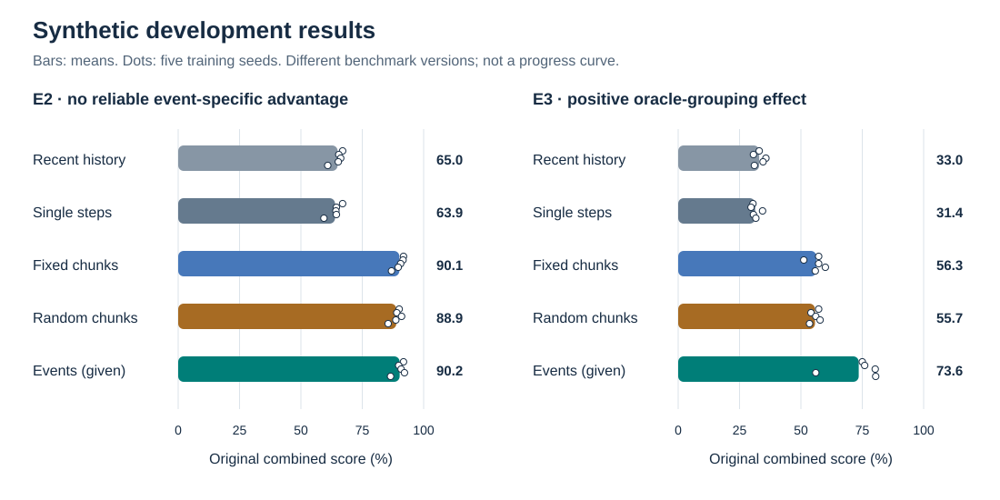

# Continual World Model with Episodic Memory

**What should a model remember about an experience so that it can use it later?**

Two experiences can involve the same people and objects but differ in who did what,
in what order, and what changed. This project studies how a model with limited memory
can keep useful information about earlier events.

The long-term goal is a model that learns from ongoing experience, remembers particular
events, and uses them to understand what happens next. The completed work tests **one
part of that goal: how to organize stored experience**. It is not yet a complete
continually learning world model.

## Start Here

| If you want to... | Open this |
|---|---|
| See what worked, what did not, and the actual numbers | [Results and plots](docs/results.md) |
| Understand the model and find its code | [Architecture and code guide](docs/architecture.md) |
| Read the full account of the completed experiments | [Research report](docs/research-report.md) |
| Understand the connection to human-memory research | [Research connections](docs/research-connections.md) |
| Check the data sources or reproduce the saved-result checks | [Datasets](docs/data.md) · [Verification guide](docs/reproducibility.md) |
| See the longer-term ideas without confusing them with results | [Research roadmap](docs/roadmap.md) |

## The Current Model

The model reads states and actions from a small simulated world. It keeps a short recent
history and a limited store of older memories. When asked about the past, it selects
stored records to help answer. The experiment changes how those records are grouped:
individual steps, fixed chunks, random chunks, or events with supplied boundaries.


The completed model experiments use **symbolic states and actions, not images, video,
speech, or brain scans**. The strongest comparison supplies the correct event boundaries;
it does not show that the model can discover them.

## What We Found

| Study | Main result | What it means |
|---|---|---|
| Earlier simulated-world test (E2) | Events **90.23%**, fixed chunks **90.12%**, random chunks **88.87%** | No reliable event-specific advantage on the original main score. |
| Harder simulated-world test (E3) | Events **73.55%**, fixed chunks **56.29%**, random chunks **55.74%** | A positive development result, with supplied boundaries; events beat each chunk baseline in **4 of 5** training seeds. |
| Sherlock recall-text test | Human scenes **69.77%**, random groups **71.53%** on the main top-five retrieval measure | Human scene grouping did not improve the main measure in this text-matching setup. |
| FilmFest behavioral reproduction | **6 of 6** released-statistic comparisons within the declared tolerance | A reproduction of existing findings, not a new memory-model result. |



E2 and E3 are different development settings, not a before-and-after progress curve.
Each used five training seeds and the same 512 validation questions within that setting.
E3 was designed after the E2 result, so it still needs an independent test.

**An important scoring check:** the original score combines ordinary answers with a task
that selects a source record. A later analysis separates them. The E3 answer-only result
is 66.98% for events versus 42.55% for fixed chunks, but events do worse on source-record
selection: 93.28% versus 97.50%. This is a post-hoc check, not a replacement for the original
main measure. [See the scoring audit and its limits](results/analysis/saved_endpoint_sensitivity_2026-11-11/REPORT.md).

## What This Does Not Yet Show

- That useful event boundaries can be learned without being supplied.
- That the model preserves relationships rather than exploiting another shortcut.
- That the result holds on new worlds, natural video, speech, or human recall.
- That fast parameter updates or slower replay-based learning improve this system.
- That it outperforms retrieval systems in general, or reproduces a brain mechanism.

The next proposed test keeps people, objects, and wording similar while changing who did
what, the order of actions, or the outcome. It asks whether memory preserves the difference.
The [research roadmap](docs/roadmap.md) lists the next comparisons and remaining controls.

## Check the Saved Results Without Training

From the repository root, with Python 3.11 or later:

```bash
python scripts/verify_release.py
python scripts/verify_research_summary.py
python scripts/build_figures.py
PYTHONPATH=src python -m unittest discover -s tests/unit -p test_next_stage_preparation.py
python -m unittest discover -s tests/unit -p test_saved_endpoint_sensitivity.py
```

These checks use saved artifacts or small invented fixtures. They do not train a model,
download datasets, use held-out participants, or submit a cluster job. The figure builder
uses the Python standard library. See the [verification guide](docs/reproducibility.md)
for the optional full software environment and remaining reproducibility limits.

## Repository Guide

```text
docs/           Research report, architecture, results, roadmap, and figures
src/cmwm/       Model, memory, simulated-world generator, and evaluation code
configs/        Configurations for the completed experiments and labeled drafts
scripts/        Saved-result checks, figure builders, and guarded execution tools
tests/          Software and protocol tests, not new scientific experiments
results/        Returned measurements, including negative results and scoring audits
archive/        Earlier reports and FilmFest analyses, kept for traceability
provenance/     Source-to-release records and checksums
cluster/        Scheduler templates; publishing does not authorize execution
```

The release excludes raw participant text, films, brain scans, credentials, and private
correspondence. Original E3 checkpoints and per-question predictions are not included;
its aggregate arithmetic can be checked, but its model outputs cannot be rerun from this
release alone. [Coverage and rights](docs/provenance.md).

**Author:** Waiz Khan. **Documentation updated:** 16 November 2026.
No collaboration with or endorsement by a referenced laboratory is implied.
Third-party sources retain their own terms; no repository-wide reuse license has been selected.
