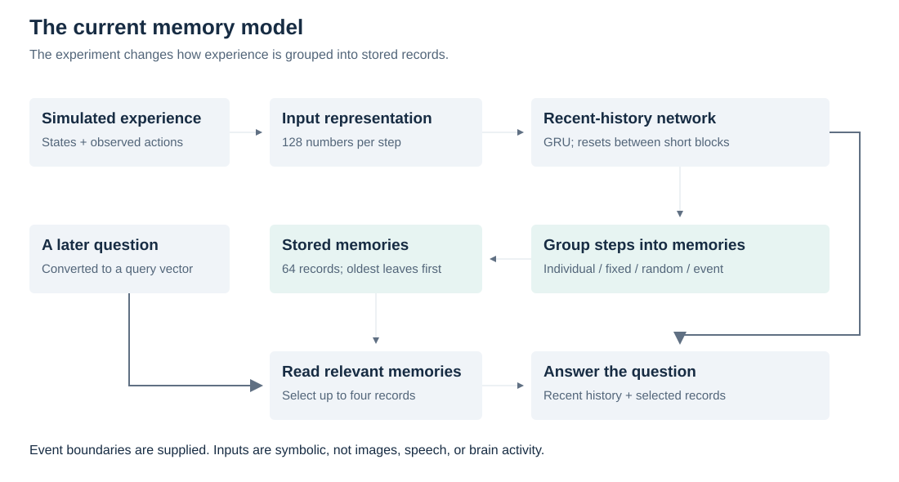

# Continual World Model with Episodic Memory

### Event-structured memory, fast adaptation, and learning across experiences

What should a model retain from its experiences when it cannot remember everything?
This project investigates a continual multimodal world model with event-structured episodic memory
as a native component. The current implementation is a **symbolic recurrent memory prototype**
testing whether meaningful event boundaries provide useful units for bounded storage. Online
fast-weight adaptation and consolidation remain research goals, not validated capabilities.

**Research status:** development evidence, not a completed foundation model or a confirmatory
benchmark result. Correct event boundaries are supplied in the strongest completed comparison.



## Start here

- [Research report](docs/research-report.md) — questions, methods, findings and limitations.
- [Architecture](docs/architecture.md) — implemented data flow versus proposed extensions.
- [Results](docs/results.md) — positive, null and exploratory findings in chronological context.
- [Reproduction guide](docs/reproducibility.md) — what can be verified from this release.
- [Data and rights](docs/data.md) — synthetic data, behavioral annotations and exclusions.
- [Research roadmap](docs/roadmap.md) — retained ideas and the tests needed to evaluate them.
- [Artifact provenance](docs/provenance.md) — original hashes, export transformations and coverage.

## Main findings

| Study | Question | Finding | Evidence class |
|---|---|---|---|
| E2 synthetic | Do event boundaries improve on ordinary chunks? | No reliable primary advantage over fixed or random chunks | Five-seed development |
| E3 revised synthetic | Does event grouping help after reducing current-state shortcuts? | 73.55% event vs 56.29% fixed and 55.74% random; 4/5 favorable seeds | Five-seed development, oracle boundaries |
| Sherlock behavioral retrieval | Do human scene groups improve lexical retrieval? | Primary hit@5: 69.77% human vs 71.53% random | Development null |
| FilmFest historical analyses | Can released behavioral statistics be reconstructed? | Behavioral checks and graph-retrieval diagnostics; not independent graph-memory validation | Reproduction / exploratory |


E3's event-versus-random difference is **+17.81 percentage points**; the paired-seed 95% t interval
is **[+3.60, +32.03]**. These intervals describe training-seed variation on a reused validation
cohort, not generalization to new worlds or people. E3 was designed after the E2 null result.
Both results must be interpreted together.

## Implementation

The prototype uses a 128-dimensional symbolic interface, local-context GRU, learned key/value
writer, bounded FIFO memory and top-four query-conditioned retrieval. C0–C4 compare context,
individual observations, fixed chunks, random length-matched chunks and oracle event chunks.
Architecture, losses and training policy are controlled across conditions; each run learns its
own parameters. A common backbone does **not** mean identical fitted weights across runs.

Learned-boundary code exists but is not scientifically validated here. True online fast weights,
replay/consolidation, raw visual/audio transfer and neural-data validation remain untested.
There is no claim of superiority over all RAG systems, human memory, or general world models.

## Inspect without training

Python 3.11+ is sufficient for the release-level checks and figure generation:

```bash
python scripts/verify_release.py
python scripts/build_figures.py
PYTHONPATH=src python -m unittest discover -s tests/unit -p test_next_stage_preparation.py
```

These commands verify stored artifacts or tiny deterministic fixtures. They do not train a
model, contact a scheduler, download data, or evaluate the sealed test cohort.

For the full software environment and cluster-specific requirements, see the
[reproduction guide](docs/reproducibility.md). Installation alone never starts experiments.

## Repository layout

```text
src/cmwm/       model, synthetic world, memory and evaluation code
configs/        experimental configurations and explicitly unfrozen proposals
scripts/        audits, analysis and guarded execution utilities
tests/          unit and protocol tests
cluster/        scheduler templates and historical analysis code
results/        returned numeric results, including null and failed-development records
docs/           report, diagrams, reproducibility and roadmap
archive/        dated plans and historical FilmFest reports
provenance/     original-to-release hashes and artifact inventory
```

The result archive is not a checkpoint distribution. In particular, E3's detailed returned
summary is included, while its original checkpoints and per-checkpoint predictions are not.
See [coverage and limitations](docs/provenance.md).

**Author:** Waiz Khan. **Research snapshot:** 30 October 2026. This release does not imply
collaboration with, or endorsement by, any referenced laboratory. Third-party data and papers
remain subject to their own terms; no repository-wide reuse license has been selected.
