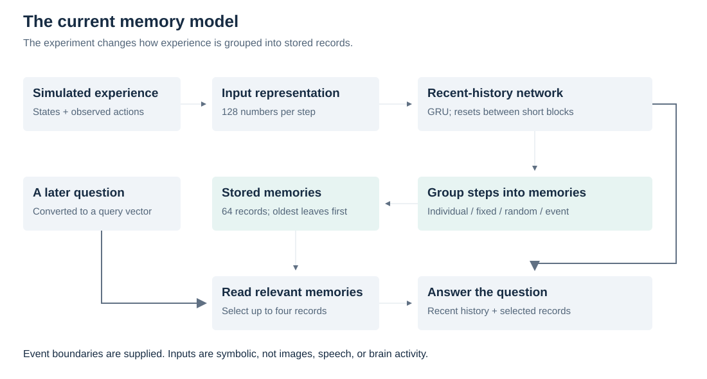
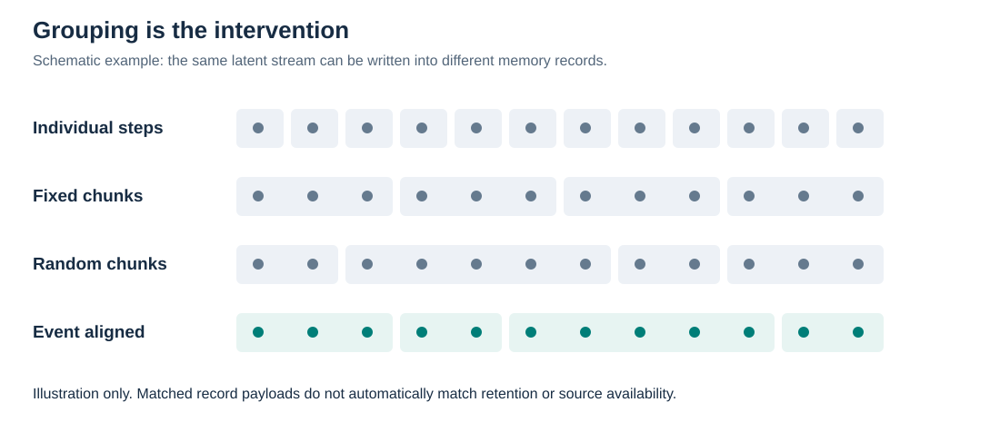
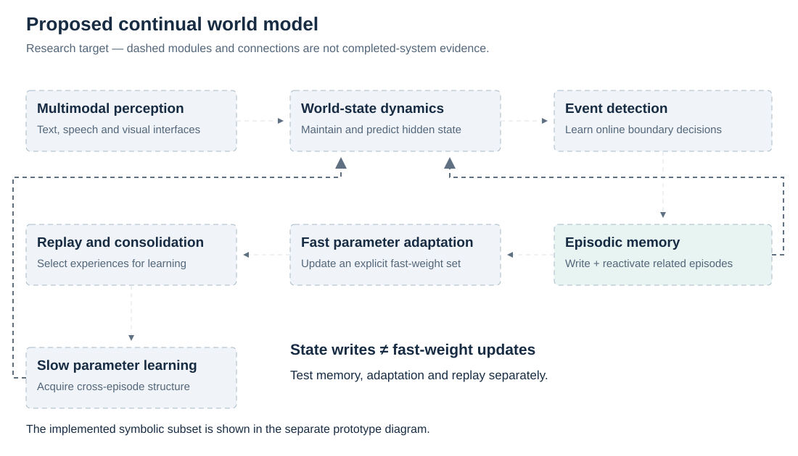

# Architecture and Implementation Status

[Project home](../README.md) · [Research report](research-report.md) · [Results](results.md)

## In Plain Language

The current model reads what happened in a small simulated world, keeps a short recent
history, and stores selected groups of earlier steps. A later question tells it which
stored memories to read. It combines those memories with recent information to answer.

This is one memory-equipped model. The long-term world-model design is a research goal,
not a second completed system. The current question-answering experiment does not establish
that memory improves open-ended prediction of future events.

## Implemented symbolic prototype

The primary implementation is [CMWM](../src/cmwm/models/cmwm.py). Its
[state/action adapters](../src/cmwm/models/symbolic.py), [GRU](../src/cmwm/models/temporal.py),
[memory writer](../src/cmwm/models/memory_writer.py), [segmenters](../src/cmwm/models/boundaries.py)
and [query head](../src/cmwm/models/queries.py) expose the comparison clearly.

1. Symbolic state and observed actions enter the same representation interface.
2. The GRU processes local blocks and resets at fixed context boundaries.
3. The chosen segmentation policy groups the latent stream.
4. A key/value writer creates fixed-width records; FIFO enforces the record ceiling.
5. Query-conditioned retrieval selects at most four available records.
6. The query head combines retrieved records and current temporal context.

## Code Guide

| Part | What it does | Source |
|---|---|---|
| Simulated world | Creates states, actions, and event annotations | [Generator](../src/cmwm/synthetic/generator.py) |
| Input representation | Converts state/action fields into 128 numbers | [State adapter](../src/cmwm/models/symbolic.py) |
| Recent history | Runs a recurrent network over short blocks | [Temporal core](../src/cmwm/models/temporal.py) |
| Grouping | Chooses where memory records begin and end | [Boundary policies](../src/cmwm/models/boundaries.py) |
| Record builder | Encodes the mean and final state of a group | [Memory writer](../src/cmwm/models/memory_writer.py) |
| Model integration | Connects grouping, a 64-record limit, and retrieval | [Integrated model](../src/cmwm/models/cmwm.py) |
| Later questions | Encodes questions and predicts answers from selected records | [Question and answer heads](../src/cmwm/models/queries.py) |
| Training and evaluation | Fits the model and records declared measures | [Training](../src/cmwm/training.py) · [Evaluation](../src/cmwm/evaluation/) |
| Completed study settings | Five comparison conditions per development setting | [E2](../configs/e2/) · [E3](../configs/e3/) |

The current network is a GRU, not a visual Transformer. The store retains at most 64
records and reads at most four for a question. The declared record allowance is 68,096
bytes, not total computer memory. Equal record limits do not guarantee equal coverage
of past experience.

An auxiliary next-state prediction head and a learned-boundary head exist in code. Their existence
does not establish predictive world-model transfer or learned-segmentation performance. The
prediction-error boundary alternative is diagnostic and must be audited for causal/online access
before making streaming-boundary claims.

## Experimental intervention

The grouping illustration is schematic, not a sampled trajectory. C0 has no episodic store; C1
writes individual observations; C2–C4 compare fixed, random length-matched and oracle event groups.
The oracle policy has privileged boundaries. Random matching controls length distributions but
does not by itself settle every retention or source-availability confound.

## Proposed complete system

In the longer-term design, new experience could change short-lived working state,
stored event records, and selected fast-changing parameters. Replaying useful experiences
could then affect more slowly learned parameters. Those are different mechanisms: writing
a new memory record is not the same as changing the model's weights.

This diagram is a research target, not an implementation claim. Perception would feed a persistent
world-state representation; events would control storage and potentially reactivation. A future
fast adaptation mechanism could update selected parameters online. Replay could gradually influence
slow parameters. Each arrow needs a separate measurable contribution.

| Mechanism | Status |
|---|---|
| Symbolic state/action interface and GRU | Implemented; used in development studies |
| Bounded key/value episodic state | Implemented; used in development studies |
| Fixed, random and supplied-event grouping | Evaluated |
| Learned boundary detector | Code present; no validated learned-boundary result |
| Dense Sherlock retrieval primitives | Draft; encoder/cache/runner incomplete |
| Held-out confirmation statistics | Draft checks; cannot certify a scientific gate |
| Visual/audio perception, true fast weights, replay | Proposed; not validated |
| Directed graph reactivation and robotics transfer | Proposed; historical graph diagnostics are not validation |

The complete retained research map is in the [dated planning archive](../archive/notes/RESEARCH_MAP.md).
