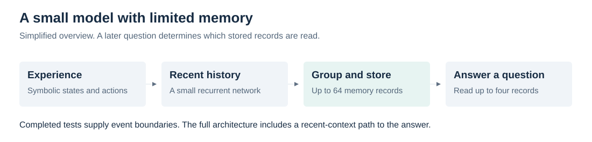

# What Should a Model Remember About an Event?

Waiz Khan | Research discussion proposal | 16 November 2026

## The Question

Two experiences can contain the same people and objects but differ in who did what,
in what order, and what changed. What must a memory preserve so that it can tell those
experiences apart later? The long-term goal is a model that learns from ongoing experience
and uses memories of particular events to understand what happens next. The current
experiments test memory organization, not that complete system.

## What Has Been Tested

A small recurrent model reads states and actions from a simulated world. It stores a
limited number of records and retrieves them to answer questions about the past. The
comparison changes whether records hold individual steps, fixed chunks, random chunks,
or events. The correct event boundaries are supplied. They are not learned in these tests.

An earlier development test, E2, found almost no difference between events and fixed
chunks: 90.23% versus 90.12% on the original main score. In a harder development setting,
E3, events scored 73.55%, compared with 56.29% for fixed chunks and 55.74% for random
chunks. Each study used five training seeds and 512 validation questions. E3 favored
events in four of five seeds, but was designed after E2 and has not been independently
confirmed. Differences in retention and available targets still need controls.

A separate text-retrieval test used Sherlock recall annotations, not brain scans. Human
scene groups scored 69.77% on the main top-five retrieval measure, versus 71.53% for
random groups, using 401 queries from 12 development participants. FilmFest work reproduced
six released behavioral statistics within a declared tolerance. Neither analysis establishes
that this model predicts human recall. A later scoring audit also shows that E3's advantage
does not hold for every task.

<!-- pagebreak -->

## The Next Experiment

The proposed test separates familiar details from remembered relationships. For example,
two episodes could contain the same person, key, box, and actions, but in one episode the
key is moved before the box is locked and in the other it is moved afterward. Later
questions would require the correct order or outcome, not just recognition of those objects.
This is an illustrative design, not a completed experiment.

First, create paired histories with independently checked answers. Keep the people,
objects, and surface details as similar as possible while changing the relationship or
order that determines the answer. Hold out new combinations, and use alternate wording
only as an additional control against text matching.

Second, test grouping and stored content separately. Compare event, fixed, and random
grouping with the same model design, training budget, storage allowance, and retrieval
budget. Measure which source information remains available, rather than assuming equal
record counts imply equal remembered history. A separate comparison would test records
that preserve order or role information against simpler summaries.

Third, freeze the questions and main measure before testing. Report each seed, uncertainty,
negative outcomes, and costs. If the model cannot distinguish the paired histories, the
experiment has not demonstrated useful relationship memory, even if its overall retrieval
score improves. Learned boundaries should be tested only after this controlled comparison.

## Connection to Human Memory

Work by Janice Chen and collaborators studies how continuous experience is organized
into events, how those events are recalled, and how connections between events relate to
memory. These findings motivate the questions here. They do not establish that this
computational implementation captures the same mechanisms.

The discussion question is: what naturalistic recall task would distinguish remembering
relationships within and between events from matching familiar details? Choosing that
task, its annotations, and an appropriate comparison to human behavior should come before
any claim about brain activity. Fast parameter updates, slower learning through replay,
and visual or speech inputs remain later, separate experiments.

## Evidence and Reading

- [Results, task-level limits, and source artifacts](results.md)
- [Model architecture and implementation status](architecture.md)
- [Baldassano et al. (2017), Discovering Event Structure in Continuous Narrative Perception and Memory](https://pubmed.ncbi.nlm.nih.gov/28772125/)
- [Lee and Chen (2022), Predicting Memory From the Network Structure of Naturalistic Events](https://doi.org/10.1038/s41467-022-31965-2)
- [Research repository](https://github.com/nolimitwaiz/continual-world-model-with-episodic-memory)
