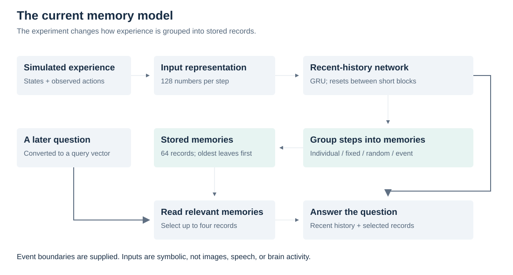
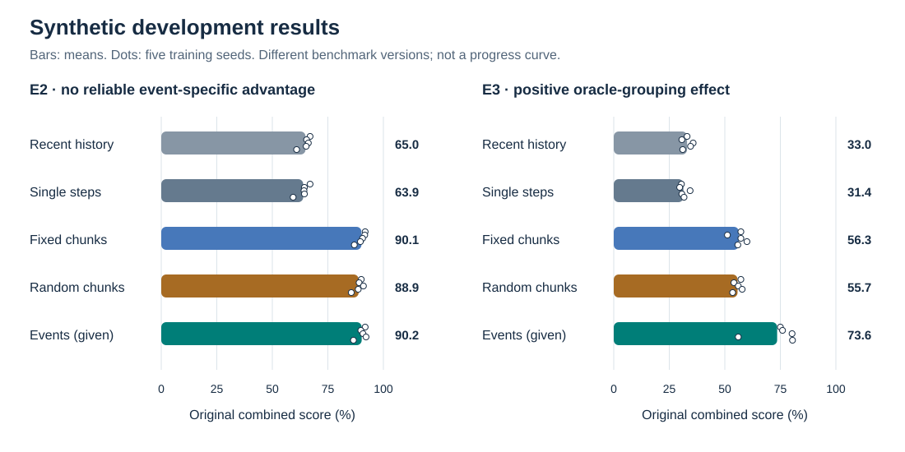
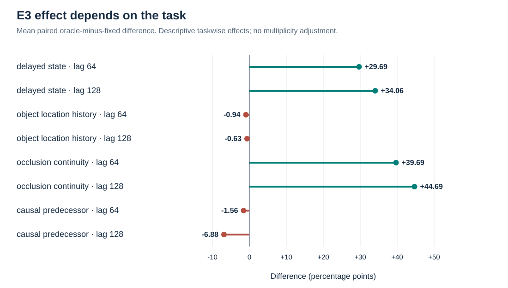
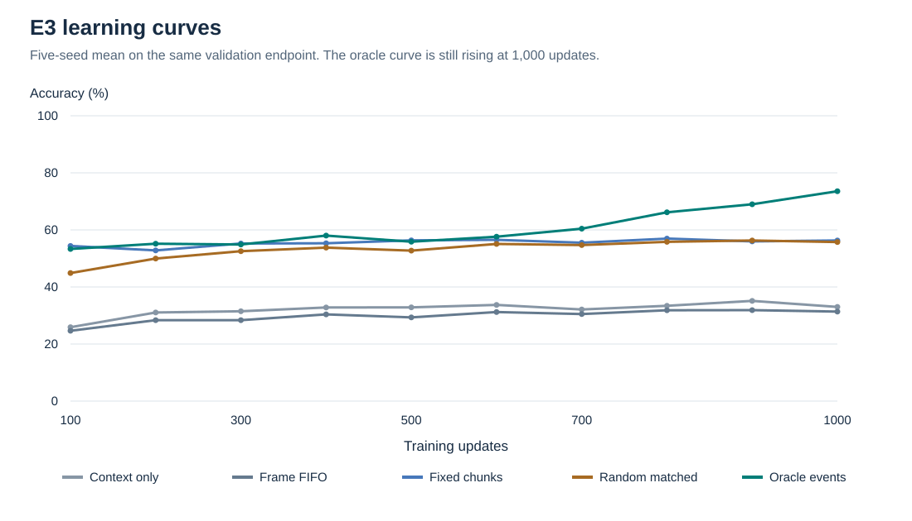
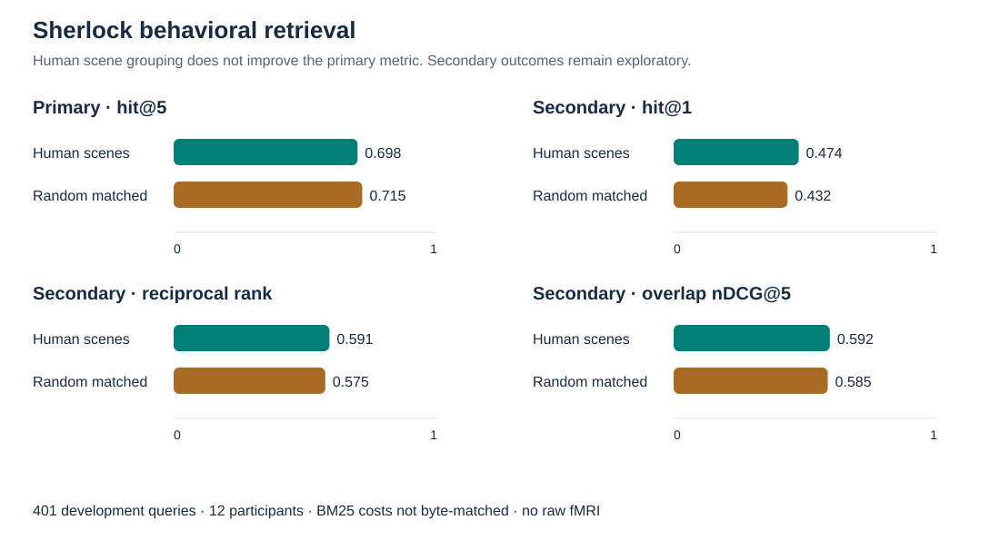

# Event-structured episodic memory under bounded storage

Waiz Khan · Research discussion report · 30 October 2026

## Summary

This work asks whether the organization of stored experience changes what a compact model can
recover after a delay. A recurrent symbolic prototype compares individual observations, fixed
chunks, random length-matched chunks and supplied event boundaries under a bounded record store.
An initial five-seed study (E2) found no reliable event-specific advantage. A revised development
study (E3), constructed after diagnosing shortcuts, found a 17.81-percentage-point event advantage
over random grouping. A separate Sherlock behavioral retrieval study did not improve its primary
metric using human scene groups. Together these results motivate a conditional hypothesis:
event organization may help when it preserves bindings needed by the task, rather than providing
a universal retrieval advantage.

## Question and scope

A model may know the current location of an object while failing to remember who moved it,
where it was earlier, or which intervening event changed it. The question is whether a useful
memory unit should correspond to an episode rather than an arbitrary time window. This is a
component-level investigation toward a world model, not a claim that a complete multimodal or
continually adapting model has been built.

The neuroscience-inspired direction is to test explicit hypotheses about event organization,
reactivation and different learning timescales. Behavioral resemblance alone would not establish
that the implementation reproduces a biological mechanism.

## Implemented system

Symbolic state and observed action fields are mapped to 128-dimensional step representations.
A GRU processes fixed local-context blocks, resetting between blocks so that its hidden state
cannot become an undeclared full-episode store. A shared-design writer encodes grouped latent
states into fixed-width key/value records. The bounded FIFO store has 64 records; the declared
record accounting is 1,064 bytes per record (68,096 bytes total). A query retrieves at most four
records and the answer head combines retrieved information with current context.

Memory grouping is the main intervention. The backbone, writer and query-head design are shared
across conditions, but runs are trained separately. Correct event boundaries are available only
to the oracle grouping condition. Causal annotations support evaluation, not unrestricted
ground-truth graph access by the model. A source-containing record is the causal endpoint; this
is not exact causal-action discovery.

The record budget is a declared logical accounting scheme, not whole-process RAM or GPU memory.
Storage, source availability and retention effects require further mechanism controls before
attributing every benefit specifically to semantic event structure.

## Experimental chronology

### Engineering and early development

Dataset validation, graph-isomorphism leakage checks, exact-resume tests, short engineering runs,
a one-seed pilot and an earlier five-seed development replication preceded E2. These records are
retained in the [artifact catalog](artifact-catalog.md). The earlier replication did not establish
an event advantage over fixed chunks and used heterogeneous hardware and a less satisfactory
endpoint. Unit-test passes and successful job exits are engineering evidence, not memory findings.

### E2: memory versus meaningful segmentation

E2 used five conditions, seeds 11/23/47/89/131, 1,000 updates, and a common 512-question validation
endpoint balanced across four tasks and two lags. Fixed chunks scored 90.12%, random chunks 88.87%,
and oracle event chunks 90.23%. The oracle-minus-fixed difference was only +0.12 percentage points;
oracle-minus-random was +1.37 points, with a paired-seed interval spanning zero.

Chunk memory substantially outperformed short context, but several task cells saturated because
current-state or persistent-state shortcuts could answer the questions. Thus the study supported
retention of older sources, not a strong event-segmentation claim.

### E3: revised confusable experiences

E3 was developed after E2 and must be reported as such. The revised world reduces the diagnosed
shortcuts and introduces more confusable histories. It again used five conditions and five seeds,
1,000 updates and 512 common validation questions (64 per task/lag cell).

| Condition | E2 | E3 |
|---|---:|---:|
| Context only | 64.96% | 33.01% |
| Frame FIFO | 63.91% | 31.37% |
| Fixed chunks | 90.12% | 56.29% |
| Random length-matched | 88.87% | 55.74% |
| Oracle event chunks | 90.23% | 73.55% |

The benchmark versions differ; absolute scores across columns are not a measure of model progress.
E3 oracle-minus-random was +17.81 points, paired-seed 95% t interval [+3.60, +32.03]. Oracle-minus-fixed
was +17.27 points, interval [+2.15, +32.38]. Four of five seeds favored events; seed 89 did not.
The strongest descriptive gains were delayed-state recall and occlusion continuity. At lag 128,
causal-source retrieval instead favored fixed chunks (95.63%) over events (88.75%).

These are development findings. Intervals quantify training-seed variability on the same questions,
not uncertainty over independently sampled worlds. Taskwise analyses are exploratory and unadjusted
for multiplicity. The event learning curve was still rising at 1,000 updates; a longer-training study
must preserve this endpoint and apply equal additional budgets to the comparison conditions.

### Sherlock: naturalistic behavioral retrieval

The separate Sherlock analysis uses released encoding labels and recall-related text, not fMRI.
It groups 1,000 encoding-label rows into fine units, fixed groups, random length-matched groups or
50 human scenes. Queries are participant recall words aggregated by coded scene. The scene identity
is evaluator information rather than model input. Twelve development participants provide 401 scored
queries; five other participants remain sealed. Source preprocessing counted more possible queries
before the development split, which must not be confused with the 401 scored queries.

The initial any-overlap metric gave random boundary-straddling records more eligible targets.
Its result was retained as a metric diagnostic. The revised, explicitly post-v1 development metric
uses a single maximum-overlap target. Under that primary metric, participant-macro hit@5 was 69.77%
for human events and 71.53% for random grouping: no primary improvement. Secondary hit@1, reciprocal
rank and overlap-graded ranking favored human groups, but cannot replace the failed primary endpoint.
BM25 record lengths and returned-token costs differ, preventing an equal-memory efficiency claim.

### FilmFest: historical reproduction and exploratory graph diagnostics

Earlier FilmFest work reconstructed released behavioral statistics and audited participant/event
mapping and missingness. This used behavioral/source-data products, not raw fMRI volumes. Exact
upstream semantic and causal graph reconstruction remained incomplete because required inputs
were unavailable. Historical reports and numeric summaries are preserved in [the archive](../archive/filmfest/).

A separate predicted-graph diagnostic used a model-predicted graph both to define required paths
and to supply graph-based retrieval. Apparent graph-retrieval improvements are therefore circular
with respect to the desired independent graph-memory claim. They are retained as exploratory
engineering diagnostics, not evidence that graph memory beats independent baselines.

## What these results support

- A functioning bounded-memory comparison platform with retained unfavorable results.
- Evidence that supplied event organization can improve selected synthetic delayed-memory tasks.
- Evidence that a favorable synthetic effect does not automatically transfer to lexical retrieval
  over human narrative annotations.
- A concrete need to distinguish retention, grouping, retrieval and representation effects.

They do not establish learned segmentation, online fast-weight benefits, continual-learning
improvements, raw visual/audio transfer, human recall prediction, fMRI alignment, robotics utility,
or superiority over all RAG systems.

## Next experiments and discussion questions

The immediate recommendation is a small, rubric-first text-memory diagnostic, with fixed questions,
matched budgets and no post-hoc replacement of primary metrics. It is not a substitute for independent
confirmation of E3. Fresh held-out construction is still necessary: the existing test generator branch
does not implement the repaired confusable worlds. Sealed test data must not be used for development.

Longer-term tests separate episodic-state updates from true fast-parameter updates using four
conditions: neither, episodic memory only, fast weights only, and both. Replay/consolidation,
boundary-triggered retrieval and graph-based relationships are further distinct interventions.

Key questions for discussion are: What task best separates useful memory from extra context? Which
representation makes event boundaries useful? Can a memory improve prediction without a question
explicitly cueing retrieval? What independent transfer test would challenge rather than favor the
proposed mechanism?

## Evidence links

- [E2 original development report](../archive/notes/E2_RESULTS_2026-09-01.md)
- [E3 original development report](../archive/notes/E3_RESULTS_2026-09-28.md)
- [E3 returned summary](../results/cluster/1806501_e3_final/summary.json)
- [Sherlock corrected aggregate artifact](../results/cluster/1764075/result.json)
- [Data scope and attribution](data.md)
- [Release provenance and unresolved reproducibility limits](provenance.md)
