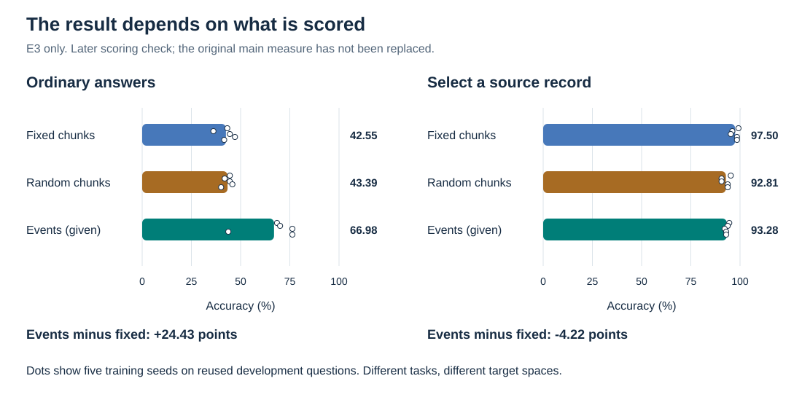
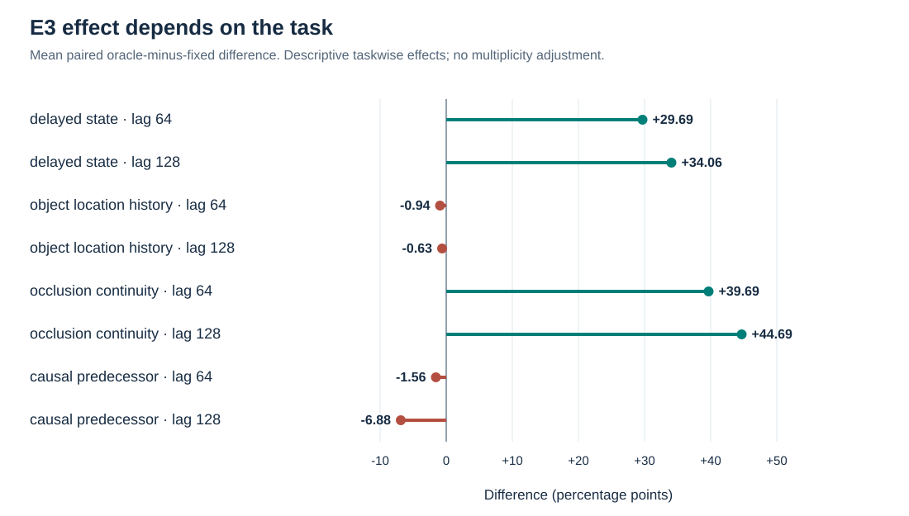

# Results and Interpretation

[Project home](../README.md) · [Research report](research-report.md) · [Model and code](architecture.md)

## The Main Results in Plain Language

Events helped in one harder simulated-world development test, but not reliably in an
earlier one. Human scene groups did not improve the main Sherlock text-retrieval score.
This is evidence worth investigating, not proof that event memory always works better.

| Setting | Individual steps | Fixed chunks | Random chunks | Supplied events |
|---|---:|---:|---:|---:|
| E2: original main score | 63.91% | 90.12% | 88.87% | 90.23% |
| E3: original main score | 31.37% | 56.29% | 55.74% | 73.55% |
| Sherlock: main top-five retrieval score | 4.25% | 68.32% | 71.53% | 69.77% |

The Sherlock individual units are short text units, not image frames. Its event groups
use human scenes. It is a different task and method from E2/E3; these rows must not be pooled.

For E2/E3, the original main score averages eight task/delay cells. Each study has five
training seeds and 512 validation questions, with 64 questions per cell. The questions
are reused across seeds. E3 is a revised development setting created after E2, not an
independent test of a hypothesis frozen beforehand.

| Comparison | Mean difference | Paired-seed 95% interval | Favorable seeds |
|---|---:|---:|---:|
| E2 events minus fixed chunks | +0.12 percentage points | [-1.81, +2.05] | 2/5 |
| E2 events minus random chunks | +1.37 percentage points | [-0.36, +3.09] | 4/5 |
| E3 events minus fixed chunks | +17.27 percentage points | [+2.15, +32.38] | 4/5 |
| E3 events minus random chunks | +17.81 percentage points | [+3.60, +32.03] | 4/5 |

These intervals describe variation across training seeds on the same questions. They do
not measure uncertainty over new worlds or new people. The event boundaries are supplied.
The model designs match, but each run learns its own weights; grouping can also change
which targets and earlier source information are available.

## An Important Scoring Check

Read the [research report](research-report.md) for methods and the [artifact catalog](artifact-catalog.md)
for available returned files. Development, reproduction and engineering results are not pooled.

The [11 November post-hoc scoring audit](../results/analysis/saved_endpoint_sensitivity_2026-11-11/REPORT.md)
separates ordinary answer tasks from causal-pointer retrieval. E3's answer-only event advantage
remains (66.98% versus 42.55% fixed and 43.39% random), while E2 stays nearly tied. The E2
chunk-versus-context composite gap should not be interpreted as a general answer-memory gain.
Original primary endpoints below remain unchanged.

The source-record task asks the model to select a stored record, so its answer space
depends on grouping. Context-only and individual-step conditions have no eligible pointer
targets here. Their zero pointer score is not proof that they cannot answer ordinary
questions about the past. In E3, events improve the answer-only diagnostic but lose to
fixed chunks on source-record selection (93.28% versus 97.50%). Neither outcome should
be hidden by the combined score.

## Naturalistic Data: What Was Actually Used

**Sherlock:** a word-matching retriever (BM25) searches descriptions using recall text.
The development analysis uses 401 queries from 12 participants and 10 random groupings.
Five other participants remain held out and unused. The main measure asks whether a
group best aligned with the recalled scene appears among the top five retrieved groups, averaged within
participants and then across participants. Human scenes score 69.77% versus 71.53% for
random groups. Different group lengths and returned text amounts limit an efficiency claim.
No fMRI was analyzed. [Original corrected result](../results/cluster/1764075/result.json).

**FilmFest:** six statistics from released figure source data were reproduced within
the prespecified absolute tolerance of 0.015. This is a check of a published analysis,
not six new experimental findings and not a model trained on FilmFest.

| Released-statistic check | Published | Reproduced |
|---|---:|---:|
| Semantic centrality and recall: correlation | 0.20 | 0.202424 |
| Causal centrality and recall: correlation | 0.29 | 0.294099 |
| Semantic high/low comparison: t statistic | 6.12 | 6.119081 |
| Causal high/low comparison: t statistic | 8.23 | 8.229111 |
| Semantic high/low comparison: paired effect size | 1.58 | 1.579940 |
| Causal high/low comparison: paired effect size | 2.12 | 2.124747 |

[FilmFest reproduction artifact](../archive/filmfest/results/filmfest_reproduction/reproduction_evaluation.json).
The upstream graphs were not independently reconstructed. An older graph-retrieval
diagnostic uses graph-defined targets and is not independent evidence for graph memory.

## Complete Experiment History

| Stage | Outcome | Appropriate interpretation |
|---|---|---|
| Dataset and structural audits | Passed declared checks; collision physics outside scope | Benchmark engineering, not model superiority |
| Resume and smoke checks | Saved states and numerical behavior checked | Execution reliability, not generalization |
| Single-seed pilot | Event grouping exceeded several controls | Pilot only; insufficient replication |
| Earlier five-seed replication | Oracle 85.08%, fixed 84.10%, random 80.35% | No reliable fixed-chunk advantage; heterogeneous hardware and endpoint limitations |
| E2 | Oracle 90.23%, fixed 90.12%, random 88.87% | Primary event-specific advantage not established |
| E3 | Oracle 73.55%, fixed 56.29%, random 55.74% | Positive development effect with supplied boundaries; confirmation incomplete |
| Sherlock v1 | Any-overlap scoring favored boundary straddling | Metric diagnostic; not a clean memory comparison |
| Sherlock v2 | Human 69.77%, random 71.53% primary hit@5 | Primary null; secondary improvements remain exploratory |
| FilmFest reproduction | Behavioral statistics/missingness checks | Reproduction of released analyses, not a new model result |
| FilmFest predicted graph | Favorable diagnostic retrieval scores | Circular graph-defined evaluation; not independent causal-memory evidence |

Points are individual training seeds; bars are means. The two panels are different benchmark
versions. Main tests use oracle versus fixed/random, not just oracle versus short context.

Task/lag differences are descriptive. A favorable aggregate does not imply every task improves.
The 1,000-update endpoint is fixed; best checkpoints are not substituted for final scores.

All figures are regenerated from included JSON by [build_figures.py](../scripts/build_figures.py).
The release verifier recomputes E2 endpoint scores from saved predictions and E3 aggregate means
and paired-seed statistics from the returned per-seed summary. It does not regenerate E3 predictions.

**No new experiments were run to create this release.** Existing results were organized and
checked; archive coverage and withheld artifacts are documented in [provenance](provenance.md).
