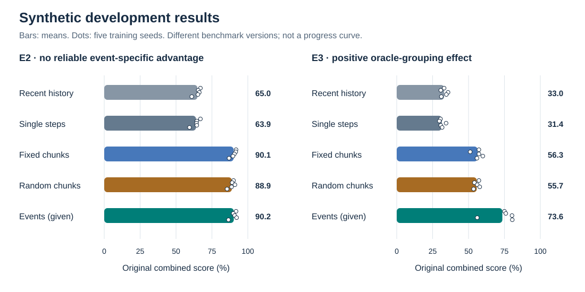
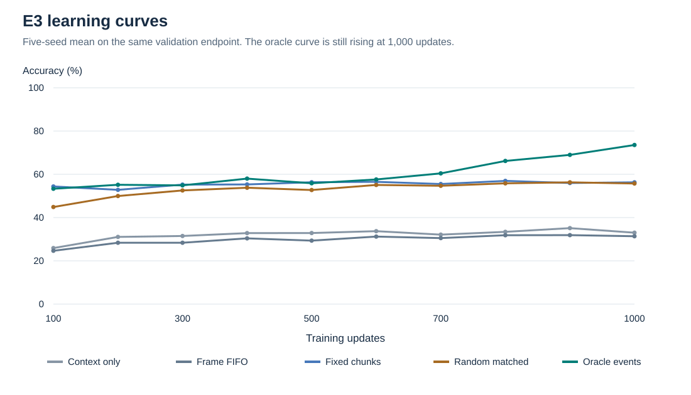
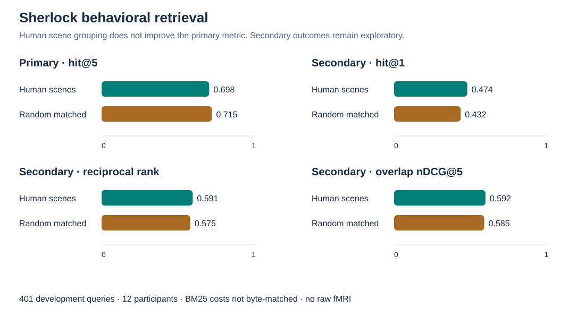

# Results and interpretation

Read the [research report](research-report.md) for methods and the [artifact catalog](artifact-catalog.md)
for available returned files. Development, reproduction and engineering results are not pooled.

| Stage | Outcome | Appropriate interpretation |
|---|---|---|
| Dataset and structural audits | Passed declared checks; collision physics outside scope | Benchmark engineering, not model superiority |
| Resume and smoke checks | Saved states and numerical behavior checked | Execution reliability, not generalization |
| Single-seed pilot | Event grouping exceeded several controls | Pilot only; insufficient replication |
| Earlier five-seed replication | Oracle 85.08%, fixed 84.10%, random 80.35% | No reliable fixed-chunk advantage; heterogeneous hardware and endpoint limitations |
| E2 | Oracle 90.23%, fixed 90.12%, random 88.87% | Primary event-specific advantage not established |
| E3 | Oracle 73.55%, fixed 56.29%, random 55.74% | Positive development effect with supplied boundaries; confirmation incomplete |
| Sherlock v1 | Any-overlap scoring favored boundary straddling | Metric diagnostic; not a clean memory comparison |
| Sherlock v2 | Human 69.77%, random 71.53% primary hit@5 | Primary null; secondary improvements remain exploratory |
| FilmFest reproduction | Behavioral statistics/missingness checks | Reproduction of released analyses, not a new model result |
| FilmFest predicted graph | Favorable diagnostic retrieval scores | Circular graph-defined evaluation; not independent causal-memory evidence |

Points are individual training seeds; bars are means. The two panels are different benchmark
versions. Main tests use oracle versus fixed/random, not just oracle versus short context.

Task/lag differences are descriptive. A favorable aggregate does not imply every task improves.
The 1,000-update endpoint is fixed; best checkpoints are not substituted for final scores.

All figures are regenerated from included JSON by [build_figures.py](../scripts/build_figures.py).
The release verifier recomputes E2 endpoint scores from saved predictions and E3 aggregate means
and paired-seed statistics from the returned per-seed summary. It does not regenerate E3 predictions.

**No new experiments were run to create this release.** Existing results were organized and
checked; archive coverage and withheld artifacts are documented in [provenance](provenance.md).
