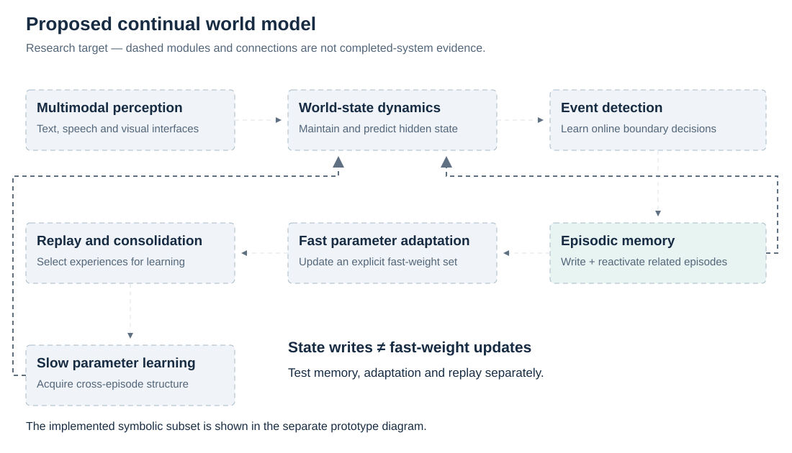

# Research roadmap

The common objective is a predictive world model that retains particular experiences while learning
general structure. The following ideas are retained hypotheses, not a list of completed achievements.

## Next Comparisons to Define Before Running

The [short research proposal](research-brief.md) gives a discussion-ready experiment:
test whether memory distinguishes histories with similar details but different relationships
or action order. It is a proposal, not a new completed result or a launch instruction.

1. Repair held-out E3 world construction and audit source availability, retention, byte budgets,
   and matched training duration before independent confirmation.
2. Separate grouping from stored content in a controlled relationship-memory task. Freeze its
   questions, baselines, and main measure before inspecting new test outcomes.
3. Preserve the Sherlock primary null. A new dense-retrieval study needs an independently
   declared protocol and must not tune on the five sealed participants.
4. Retain the visual-memory branch: observation-only rendered worlds, then a carefully audited
   CATER subset. Visual preparation is not evidence of visual training or successful transfer.

The longer-term tracks below remain in the plan. A compact proposal does not remove them;
it selects one question that can be tested without changing every component at once.

No new training or cluster submission is authorized by publishing this repository.

## Memory mechanisms

| Hypothesis | Decisive comparison | Status |
|---|---|---|
| Events are useful storage units | Oracle vs fixed/random with independent worlds and matched retention | Positive E3 development result; confirmation incomplete |
| Useful boundaries can be learned online | Learned boundaries vs fixed/random and an oracle ceiling | Detector code; no validated result |
| Boundaries should also cue retrieval | Boundary-triggered vs periodic/random/always-on budget-matched reads | Proposed |
| Fast weights complement episodic state | Neither / state-only / fast-weight-only / both | Proposed |
| Replay supports slower generalization | No replay / uniform replay / selected replay with matched updates | Proposed |
| Event relationships improve retrieval | Vector vs relational retrieval using independent relation labels | Proposed; older predicted-graph diagnostic is circular |
| Structural analogy survives new labels | Relabeling/isomorphism controls plus held-out relational tasks | Structural audit code; not a validated graph reasoning model |

Fast episodic writes change state, not parameters. True fast weights require an explicit online
update rule. Slow weights in the existing prototype are ordinary training parameters; successful
fast/slow consolidation has not been demonstrated.

## Perception and dynamics

- **Text, speech and vision:** begin with a controlled interface, then test matched experiences
  across modalities. Treat perception adequacy and memory performance as distinct outcomes.
- **DINO / CLIP / latent-prediction objectives:** retained representation alternatives, not encoders
  used in the completed symbolic E2/E3 studies. Paired-language supervision is a separate change.
- **Non-Transformer representations:** compare conventional CNN/recurrent interfaces before
  interpreting architectural novelty as an advantage. The current symbolic temporal core is a GRU.
- **Liquid / continuous-time dynamics:** require irregular sampling and baselines with access to
  the same elapsed-time information.
- **Weight-tied recursion and adaptive stopping:** require tasks with controlled reasoning depth
  and matched compute accounting.
- **Alternative learning rules and test-time adaptation:** separate objective, parameter count,
  adaptation budget and backbone changes; do not combine them into one uninterpretable intervention.
- **Robotics:** eventual partial-observability and action-conditioned prediction tests; no current
  robotics result or validated controller is claimed.

## Longer-term neural and language ideas

Brain2Qwerty and TRIBE-related comparisons are retained as possible future research connections,
not implemented or interchangeable models for the current datasets. Modality, task, labels,
access and scientific relevance must be checked before selecting an experiment. Raw fMRI and
neural decoding are not part of the current result claim. Poetry and multilingual/visual-orthography
branches remain deferred rather than removed from the historical master plan.

The [full dated research map](../archive/notes/RESEARCH_MAP.md) preserves additional hypotheses
and earlier sequencing. It is a historical planning document; this page defines the release's status.
